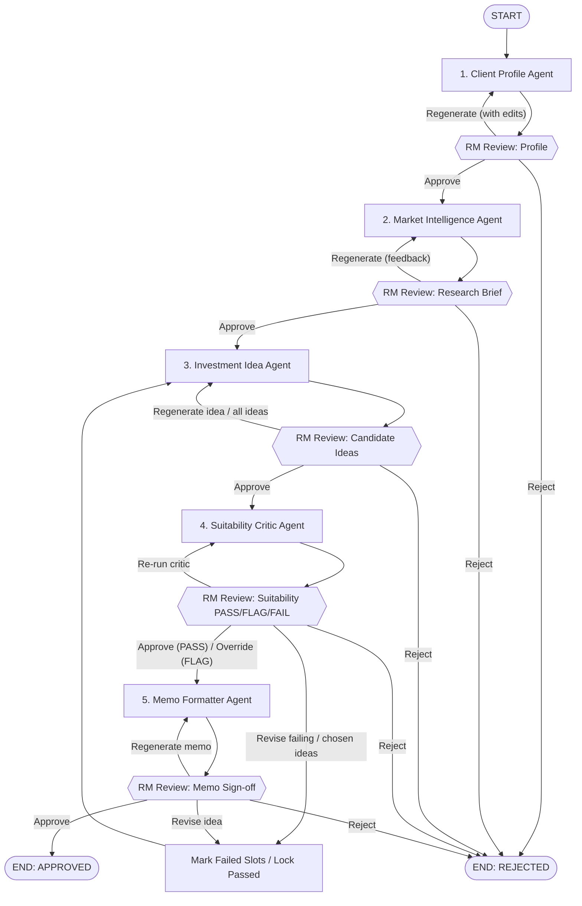

# UBS Human-Led Multi-Agent Financial Advisory System

A production-grade, human-in-the-loop multi-agent financial advisory platform built with **LangGraph**, **Pydantic v2**, and **FastAPI / Streamlit**, fully complying with the UBS wealth management advisory and risk governance architecture.

---

## 1. Architectural Principles & Governance

1. **Clear Role Boundaries**: Every agent owns exactly one type of reasoning. Ideation, market intelligence, suitability critic validation, and memo compilation are strictly isolated into distinct agents with typed schemas.
2. **Deterministic Control**: Arithmetic, portfolio weights, asset class concentration thresholds, risk scoring, liquidity coverage, and mandatory schema checks are 100% computed by pure Python deterministic tools—never delegated to LLM free-text reasoning. `src/tools/` is architecturally linted to never import LLM code.
3. **Evidence Before Recommendation**: Every market claim requires an explicit source ID, publication date, and freshness timestamp (older than 45 days is automatically discarded). Ideas without verified fresh citations cannot pass suitability.
4. **Lowest Effective Level of Automation & Human Accountability**: The Relationship Manager (RM) is the Human Orchestrator. The graph pauses for an RM review **after every agent**. At each checkpoint the RM sees the agent's rendered output and can:
   - **Approve** — continue to the next agent (flags are marked resolved with the RM's note)
   - **Regenerate** — re-run the same agent with RM feedback (Client Profile: with edited intake fields)
   - **Reject** — end the session, recorded in the audit trail as `REJECTED`

   Stage-specific controls:
   - **Client Profile**: approval is disabled while mandatory fields are missing — the RM must supply them and regenerate.
   - **Investment Ideas**: regenerate a single idea (other slots stay locked) or the whole set.
   - **Suitability Critic**: `PASS` can be approved; `FLAG` needs an `override_flag` with a justification note; `FAIL` must be sent back (`revise`) unless regeneration attempts are exhausted.
   - **Memo**: sign off, regenerate the memo, or `revise` an individual idea.

---

## 2. Multi-Agent Pipeline & State Machine



---

## 3. The 5 Specialized Advisory Agents

### Agent 1: Client Profile Agent (`src/agents/client_profile.py`)
- **Role**: Ingest, standardize, reconcile, and validate advisor-entered client inputs (goals, horizon, liquidity needs, risk tolerance, current holdings).
- **Deterministic Tools**:
  - `required_field_validator(profile_dict) -> ValidationResult`
  - `risk_profile_calculator(questionnaire_data) -> CalculatedRiskTier`
  - `portfolio_parser(raw_holdings) -> StandardizedHoldings`
- **Guardrail**: Compares risk willingness vs risk capacity. If a client states aggressive risk tolerance but has a short-term 18-month liquidity commitment, raises `RISK_CAPACITY_CONFLICT` and triggers an interrupt. Cannot infer missing information.

### Agent 2: Market Intelligence Agent (`src/agents/market_intelligence.py`)
- **Role**: Transform broad macro research and market data into evidence-backed intelligence filtered for client profile gaps.
- **Deterministic Tools**:
  - `quantitative_analysis_tool(ticker) -> QuantMetrics` (1Y/3Y returns, vol, max drawdown, momentum, P/E)
  - `sentiment_analysis_tool(corpus_docs) -> SentimentBreakdown`
  - `retrieval_rag_tool(query, asset_universe) -> List[DocumentSnippet]`
  - `source_freshness_validator(snippets, max_age_days=45) -> ValidatedSnippets`
- **Guardrail**: Every finding has attached source IDs, publication dates, and freshness tags. Stale evidence (>45 days) is automatically discarded.

### Agent 3: Investment Idea Agent (`src/agents/investment_idea.py`)
- **Role**: Synthesize profile and research brief into candidate investment opportunities.
- **Behavior**:
  - Generates **exactly three** complementary candidate ideas covering distinct portfolio roles (`GROWTH`, `INCOME`, `STABILITY`, `DIVERSIFICATION`).
  - **Selective Regeneration**: If Idea #2 is rejected by RM or Critic, Ideas #1 and #3 are locked and preserved verbatim. Only Slot #2 is regenerated.
- **Deterministic Tools**:
  - `approved_product_universe_tool(asset_filters) -> List[ApprovedInstrument]`
  - `portfolio_exposure_calculator(current_holdings, proposed_trades) -> ExposureDelta`

### Agent 4: Suitability Critic Agent (`src/agents/suitability_critic.py`)
- **Role**: Independent risk engine validating candidate ideas against client profile and institutional limits.
- **Status Gates**:
  - **`PASS`**: Meets all limits; routes directly to Memo Formatter.
  - **`FLAG`**: Soft guideline breach (e.g. single stock 20-30%, US equity 50-65%); pauses graph for RM exception review.
  - **`FAIL`**: Hard breach (single stock > 30%, US equity > 65%, liquidity coverage < 1.0x, missing/stale evidence); routes back to selective regeneration.
- **Deterministic Tools**:
  - `portfolio_risk_engine(current_portfolio, candidate_ideas) -> RiskMetrics`
  - `suitability_rule_engine(client_profile, proposed_portfolio) -> RuleCheckResult`
  - `evidence_integrity_check(candidate_ideas, research_brief) -> EvidenceStatus`

### Agent 5: Memo Formatter Agent (`src/agents/memo_formatter.py`)
- **Role**: Compile approved ideas and risk findings into a standardized 3-page audit-ready UBS advisory memo and ReportLab PDF artifact:
  - **Page 1: Executive Recommendation**: Client snapshot, objective, and recommendations at a glance table.
  - **Page 2: Investment Idea Details**: Specifications, theses, catalysts, allocation ranges, key risks, invalidation triggers, and citations.
  - **Page 3: Portfolio View & Disclosures**: Portfolio-level impact, stress test scenario analysis, risk disclosures, and RM signature block.
- **Deterministic Tools**:
  - `memo_consistency_validator(critic_output, memo_content) -> bool`
  - `citation_source_mapper(memo_text, evidence_list) -> List[str]`
  - `pdf_memo_renderer(structured_memo, output_path) -> str`

---

## 4. 3-Panel Advisor Workspace Frontend (Slide 20)

Launch the Streamlit workspace:
```bash
streamlit run streamlit_app.py
```

The workspace provides:
1. **Left Panel (Workflow Progress)**: Real-time stage tracking across `[Client Profile, Research, Investment Ideas, Risk Review, Advisor Approval, Memo]` with status badges (`✅ Done`, `🔄 Active`, `⚠️ RM Action`). Includes an Advisor Notes log.
2. **Center Panel (Decision Space)**: Displays stage output, before-and-after allocation shift tables, risk warning boxes with exact breach metrics, candidate idea cards, and RM command buttons (`Accept`, `Reject(idea_id)`, `Revise(idea_id, notes)`, `Confirm Exception Override`, `Resolve Profile Conflict`).
3. **Right Panel (Interactive Memo Preview)**: Dynamic preview highlighting the exact paragraph or table affected by the active workflow stage, plus one-click download for the compiled 3-page PDF memo artifact.

---

## 5. REST API Endpoints (FastAPI)

Run the backend API:
```bash
uvicorn src.api.app:app --host 0.0.0.0 --port 8000 --reload
```

| Method | Endpoint | Description |
|---|---|---|
| `POST` | `/sessions` | Start advisory session with client profile input |
| `GET` | `/sessions/{id}` | Get 3-panel workspace view projection |
| `POST` | `/sessions/{id}/actions` | Execute RM review decision (`approve`, `regenerate`, `reject`, `revise`, `override_flag`, `add_advisor_note`; optional `idea_id`, `notes`, `edits`). Returns 400 if the action is not allowed at the current checkpoint. The workspace view's `pending_review` shows the agent output under review and its `allowed_actions`. |
| `GET` | `/sessions/{id}/pdf` | Download finalized 3-page UBS advisory memo PDF |
| `GET` | `/sessions/{id}/audit` | Full audit trail of agent executions and RM decisions |
| `GET` | `/health` | Service health check |

---

## 6. Running the Validation Test Suite

Run all unit, deterministic, and integration trajectory tests offline:
```bash
python -m pytest tests/ -v
```

### Test Coverage Highlights:
- **`tests/unit/test_schemas.py`**: Asserts `CandidateIdeaSet` strictly validates exactly 3 complementary ideas across slots 1, 2, 3 with distinct instruments.
- **`tests/unit/test_risk_engine.py`**: Asserts single-stock concentration >30% triggers `FAIL`, 20-30% triggers `FLAG`, and compliant portfolios trigger `PASS`.
- **`tests/unit/test_profile_tools.py`**: Asserts risk willingness vs capacity contradiction detection (short-term 18-month liquidity need vs aggressive willingness).
- **`tests/unit/test_retrieval_freshness.py`**: Asserts stale evidence (>45 days) is discarded; fresh evidence kept.
- **`tests/unit/test_memo_consistency.py`**: Asserts memo validator fails if memo alters tickers or allocations; verifies 3-page ReportLab PDF generation.
- **`tests/unit/test_architecture_lint.py`**: Asserts `src/tools/` contains zero LLM imports.
- **`tests/integration/test_trajectories.py`**: Asserts `FAIL` status routes to regeneration and **never reaches memo formatter directly**; asserts selective regeneration locks passed ideas while only regenerating rejected slots; verifies full trajectory to final PDF memo.