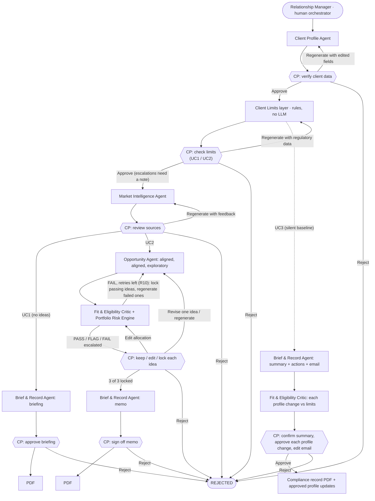

# UBS Human-Led Multi-Agent Financial Advisory System

A human-led multi-agent investment advisory application for UBS financial advisors (Relationship Managers), built with **LangGraph**, **Pydantic v2**, **OpenRouter**, **FastAPI** and **Streamlit**. It implements the *UBS OneView* design (AFC × UBS · IS4000, Prism draft 2): three moments around every client meeting, one agentic workflow, the Relationship Manager (RM) as the human orchestrator. The app is the advisor's decision workspace; PDFs are the final artifacts.

---

## 0. Setup

Run every command from this folder (`FA-Main`). No API key is needed to run the app, the tests or the evaluation: **Offline** mode uses scripted test data. A key is only needed for **Live** mode.

### Environment

Python 3 with `pip`. Tested on Python 3.14.7 (Windows 11).

```bash
python -m venv .venv
.venv\Scripts\activate             # Windows
source .venv/bin/activate          # macOS / Linux
pip install -r requirements.txt
```

### Dependencies

All are listed in `requirements.txt` (minimum versions):

| Package | Used for |
|---|---|
| `streamlit`, `altair`, `pandas` | Advisor workspace and its charts |
| `langgraph`, `langchain-core` | Agent workflow and advisor checkpoints |
| `pydantic` | Typed agent inputs and outputs |
| `httpx` | OpenRouter calls (Live mode) |
| `python-dotenv` | Reads the API key from `.env` |
| `reportlab` | Memo, brief and record PDFs |
| `pyyaml` | Suitability policy (`config/suitability_policy.yaml`) |
| `fastapi`, `uvicorn` | REST API |
| `mcp` | Optional MCP tool server (`src/mcp_tools/`) |
| `pytest` | Tests |

### Run

```bash
streamlit run streamlit_app.py      # advisor workspace: http://localhost:8501 (sign in with any email and password)
python -m pytest -q                 # tests, offline
python -m src.evaluation.scorecard --out reports/oneview_evaluation.md --json reports/oneview_evaluation.json
```

In the app, **Settings → Run mode** chooses **Offline · test data stubs** (default) or **Live · OpenRouter**.

### API key (Live mode only)

1. Create an account at [openrouter.ai](https://openrouter.ai), add credits, and create a key under **Keys**.
2. Copy `.env.example` to `.env` and paste the key:
   ```
   OPENROUTER_API_KEY=sk-or-v1-...
   ```
3. Restart the app and pick **Live · OpenRouter** in Settings.

`.env` is listed in `.gitignore`: never commit it or paste the key into code. In Live mode, client details are sent to the model provider and each run uses credits (a Discover run with Claude Sonnet 4.5 cost about US$0.25 in our tests). Optional settings are in `.env.example`.

### Datasets

Everything the app needs is in the repository; nothing is downloaded at run time.

| Included | Contents |
|---|---|
| `data/samples/client_profiles.json` | Fictional demo clients (Sarah Tan, Daniel, Mdm Lim, Aaron, Charlotte) |
| `data/samples/meeting_transcripts.json` | Demo meeting transcript for the Record use case |
| `data/research/corpus.json` | Fixed sample of 8 dated research notes used by retrieval |
| `data/market/prices/` | Fixed market-data snapshot and illustrative 3-month moves |
| `data/universe/approved_products.json` | Approved product universe with risk, complexity and liquidity ratings |
| `config/suitability_policy.yaml` | Suitability rules, limits and thresholds |

| Not included | Why |
|---|---|
| Real client data | Only fictional clients may be used. New clients entered in the app stay in the browser session |
| `.env` (API key) | Secret |
| `data/runs/` (audit run logs) and `data/pipeline_data/*.pdf` (generated PDFs) | Created when the app runs |
| Evaluation outputs in `reports/` | Created by the evaluation commands; rerun them to reproduce the results |
| Live market or research feeds | The prototype uses the fixed files above. A production version would replace them with the bank's feeds |

To add a demo client, add an entry to `client_profiles.json` with the same fields as the existing ones.

---

## 1. Design Principles

1. **Clear role boundaries**: five agents plus a rule layer, each owning one kind of work, hand off typed Pydantic objects. Agents reason, tools calculate or retrieve, controls constrain.
2. **Human accountability by design**: the advisor confirms inputs, reviews research, decides on recommendations and approves the memo. No PDF exists before advisor sign-off.
3. **Evidence before recommendation**: every market claim carries a source and publication date; sources older than 30 days are excluded (R8).
4. **Deterministic control where possible**: risk scores, exposures, allocation totals and every suitability rule run in pure Python (`src/tools/`, linted to never import LLM code). Models handle language, relevance and synthesis.
5. **Lowest effective level of automation**: research and drafting are automated; client understanding, exceptions and final approval stay with the advisor.

---

## 2. Use Cases: Three Moments, One Set of Agents

The RM is the **human orchestrator**: every agent hands a typed output to a checkpoint, and nothing moves on without the RM. Each use case has its own trigger and path through one LangGraph graph; set `use_case` in the intake payload (the API defaults to `adhoc_request`). The agent sequence per use case is written to the run log as `orchestration` (`CP:` marks an RM checkpoint).

| Use case | Trigger | Path | Checkpoints | Output |
|---|---|---|---|---|
| **UC1 Prepare** · `pre_meeting` | "I'm meeting Sarah tomorrow. What should we discuss?" | Client Profile → **Client Limits** → Market Intelligence (last 3 months, CIO research first, RM-entered news) → Brief & Record. Ideas only if the RM opts in | Verify client data · Check limits · Review sources · Approve briefing | Briefing PDF: profile and changes, **portfolio impact** (which holdings moved, by how much: facts only), CIO views with sources, what UBS can offer, open actions from the last meeting, points and questions |
| **UC2 Discover** · `adhoc_request` | "What could suit Sarah, and why?" (S$120k to deploy) | Client Profile → Client Limits → Market Intelligence → **Opportunity Agent** (two lanes) → **Fit & Eligibility Critic** (FAIL: regenerate only the failed idea, then re-check the whole set) → Brief & Record memo | Verify client data · Check limits · Review sources · Keep / edit / lock each idea · Sign off memo | 3-page memo PDF. Ideas: 2 aligned + 1 exploratory, each with why, sources, risks to raise, indicative range, fit check, eligibility and disclosures |
| **UC3 Record** · `post_meeting` | "What did we agree, and is it on record?" (upload notes or transcript in `transcript`) | Client Profile → Client Limits (silent baseline) → Brief & Record (summary, actions, email) → Fit & Eligibility Critic (profile changes vs limits and risk band) | Confirm summary and actions · approve **each** profile change · edit the email · confirm | Compliance record PDF; approved profile updates (`approved_profile_updates`); the record feeds the next briefing via `previous_meeting_record`. **The client's agreement is never changed automatically** |

`market_event` (Reassess) from the earlier draft still runs through the API but is not part of the deck and is not offered in the Streamlit app. Within one browser session the client record carries forward: an approved UC1 brief becomes the new `last_review`, approved UC2 trades are assumed executed, and a confirmed UC3 record feeds the next UC1 briefing.

### Orchestration



| Checkpoint | Advisor actions | Notes |
|---|---|---|
| Client profile | `approve`, `regenerate` (with `edits` to the intake fields), `reject` | Approve is unavailable while mandatory fields are missing (R1). Approving resolves flags such as R5 with the advisor's note. |
| Client limits (UC1, UC2) | `approve`, `regenerate` (`edits.regulatory_profile` supplies missing data), `reject` | A `BLOCKED` offer map (missing regulatory data, or an agreement with no advice) cannot be approved. Approving with open escalation flags (PEP, expired CKA) needs a `notes` entry on how they are handled. |
| Research brief | `approve`, `regenerate` (notes become feedback), `reject` | The RM sees every source, its date and whether it is CIO research or RM-entered. UC1 `approve` takes `edits.include_ideas` (default false). |
| Recommendations (UC2) | `lock_idea` / `unlock_idea` (per idea, no common accept button; a FLAG needs `notes`; a FAIL can never be locked), `revise` (one idea via `idea_id`), `edit_allocation`, `regenerate`, `reject` | FAILed ideas are regenerated automatically up to 2 times per idea before reaching the RM (R10). An idea blocked by client limits is never shown (see below). |
| Final approval (UC2) / Briefing (UC1) | `approve` (generates the PDF), `regenerate`, `revise`, `edit_allocation`, `reject` | Approve is unavailable if the document fails R9 wording, the consistency check or (UC1) S1 sourcing. UC1: the RM selects the points to raise with `edits.talking_points` (at least one of the drafted points, unchanged); the rest are kept on the brief as `points_not_raised` for audit, not in the PDF. |
| Meeting record (UC3) | `approve_change` / `reject_change` (with `item_id` = the change id; approving a change the Critic flagged needs `notes`), `edit_record` (`edits.actions[]` with `action_id`, `owner`, `due_date`, `description`; `edits.email_subject` / `edits.email_body`), `approve`, `regenerate`, `reject` | `approve` is available only when every profile change is decided, no action is still flagged and no check FAILs. |
| Market-event decision (earlier draft) | `maintain`, `monitor` (`edits.follow_up` required), `revise` | A market event never places a trade. |

`add_advisor_note` can be sent at any time; it is logged but never acts as a review decision. Advisor notes and feedback are passed to models as quoted data, not instructions.

### Idea lanes, and what is never shown

- **Two lanes** (`lane` on every idea): slots 1 and 2 are `ALIGNED` (build on the current portfolio); slot 3 is `EXPLORATORY` (labelled, within client limits). Set by code, not the model. Each idea also carries `indicative_amount_range`, `required_disclosures`, the why, sources and risks.
- **Selective regeneration**: a failed idea is regenerated alone, the passing ideas are locked and passed to the Opportunity Agent as context, and the **whole set is re-checked** for fit and eligibility.
- **Blocked ideas**: the Opportunity Agent is only given eligible products. If an idea still breaches client limits (rule E1) it is FAILed and regenerated; if it ever reaches the RM (R10 escalation) its product is withheld: name, ticker, text and any mention in the payload, history or lineage are replaced (`src/graph/redaction.py`). Idea ids are opaque handles that do not encode the product. The offer map shown to the RM lists blocked *areas* and gaps, never blocked products.

---

## 2b. Client Limits: What UBS Can Offer (`src/tools/client_limits.py`, `client_limits:` in the policy)

A rule layer, not an AI judgement. It reads `regulatory_profile` from the intake and maps it against the product universe **before** any briefing or idea. Output (`OfferMap`): eligible products with required disclosures, blocked areas, gaps, escalation flags and a status (`CLEAR` / `GAPS` / `ESCALATE` / `BLOCKED`).

```json
"regulatory_profile": {"domicile": "Singapore", "booking_centre": "Singapore", "agreement_type": "Advisory",
  "investor_classification": "Retail", "pep_status": false, "restrictions": ["no_high_yield"],
  "cka_valid_until": "2028-03-31", "tax_forms": [{"form": "W-8BEN", "valid_until": "2028-12-31"}]}
```

| Input | Effect |
|---|---|
| Missing `domicile`, `booking_centre`, `agreement_type` or `investor_classification` | Gap listed, status `BLOCKED`, nothing offered (never guessed) |
| `agreement_type` Execution-only | No recommendations: `BLOCKED` |
| US person (`domicile: US`) | Non-US-domiciled funds blocked |
| `booking_centre` not distributing a fund's registration jurisdiction, or an asset class | Cross-border restriction (see below): those products are blocked as areas such as *Cross-border restriction: US-domiciled funds* with the rationale *Fund not registered for distribution in booking centre [Hong Kong]*. A booking centre with no entry in the matrix is a gap and blocks everything (never guessed) |
| CKA missing / expired | Specified products (complexity ≥ 2) blocked, gap listed, escalation flag. Expiring within 60 days: gap only |
| US-domiciled products | Need a valid W-9 (US person) or W-8BEN; missing or expired blocks them |
| `pep_status` | Gap and escalation flag; the RM documents the handling at the limits checkpoint |
| `restrictions` (`no_single_stocks`, `no_high_yield`, `no_commodities`) | That area is blocked |

**Cross-border distribution (deck slide 26)**: `cross_border_distribution_matrix` in `config/suitability_policy.yaml` maps each booking centre (Singapore, Hong Kong, Switzerland, UK) to the fund jurisdictions it may distribute and the asset classes it may offer; `_filter_universe()` applies it deterministically to the whole universe (funds and cash instruments by legal domicile; every product by asset class; single stocks are not registered funds). Shifting the booking centre therefore prunes unregistered products with the same result every time, and a spoken change of booking centre in UC3 is checked the same way.

Illustrative thresholds: calibrate against UBS / MAS / SFC distribution rules before any pilot. In UC3 the Critic reuses the layer to test a spoken change (e.g. a move of domicile): it re-runs the offer map with the change applied to a copy and reports newly blocked areas, gaps and escalations; income, employment and horizon changes are checked against the risk band or flagged as a capacity change.

---

## 3. Suitability Rule Engine (`src/tools/risk_engine.py`, `config/suitability_policy.yaml`)

| # | Check | Default | Outcome |
|---|---|---|---|
| R1 | Mandatory fields: objective, horizon, risk profile, liquidity need, investable amount | any missing | BLOCK |
| R2 | Instrument in the approved universe file | not found | FAIL |
| R3 | Post-trade allocations sum to 100% (purchases are funded) | ±0.01 pt | FAIL |
| R4 | Proposed portfolio risk score within the client's band (shown to the RM on a 0-100 scale; the rule compares on 1-5) | band ceiling | FAIL (FLAG if an existing breach is not worsened) |
| R5 | Risk willingness above risk capacity | any gap | FLAG, lower band applied |
| R6 | Growth-asset share when the horizon is 3 years or less | cap 30% | FAIL (FLAG if existing, not worsened) |
| R7 | Single market, sector or instrument share after the change | 30% (instrument: client limit if lower) | FLAG existing, FAIL if new or worsened |
| R8 | Every cited source retrieved and within the freshness limit | 30 days | FAIL missing, FLAG stale |
| R9 | Prohibited wording ("guaranteed", "risk-free"); negated uses allowed | any match | FAIL |
| R10 | Automatic regenerations of the same idea | max 2 | Escalate to advisor |
| E1 | Client limits: product is in the client's offer map | not eligible | FAIL (never shown to the RM) |
| M1 | MARKET_SIGNAL_CONFLICT: research disagrees on the idea's instrument (see Research freshness) | conflict on the ticker, or a sector / theme conflict among sources covering it | FLAG (the RM documents how they weighed it) |
| L1 | Liquid assets cover liquidity needs due within 24 months | 1.0x | FAIL (FLAG if existing, not worsened) |

Thresholds are illustrative defaults held in configuration and must be calibrated against UBS suitability policy before any pilot. Passing risk is not the same as being eligible or suitable: E1 is independent of R4. A portfolio-level FAIL is attributed to the smallest set of ideas whose removal fixes it, so only those slots are regenerated.

---

## 4. The Agents

| Agent (deck name · code) | Role and design boundary | Deterministic tools |
|---|---|---|
| **Client Profile** · `client_profile.py` | Turns advisor-verified inputs, notes and portfolio data into a structured Client Advisory Profile; detects missing or conflicting data. Never invents missing high-stakes client information | `required_field_validator`, `risk_profile_calculator`, `portfolio_parser` |
| **Client Limits layer** · `client_limits.py` (no LLM) | Maps what UBS can offer: eligible products, disclosures, blocked areas, gaps, escalations. A blocked product is never shown; a gap is listed, never guessed. Shared by UC1 and UC2 | `client_limits_engine`, product universe, document-date checks |
| **Market Intelligence** · `market_intelligence.py` | Turns CIO research and RM-entered news into dated, sourced evidence; CIO first, external news only by exception (never used in the prototype); UC1 adds the 3-month portfolio impact. Reports facts and sources; does not decide suitability or go beyond the evidence | `retrieval_rag_tool`, `source_freshness_validator`, `quantitative_analysis_tool`, `sentiment_analysis_tool`, `portfolio_impact_tool` |
| **Opportunity Agent** · `investment_idea.py` (`OpportunityAgent`) | Ideas for discussion in two lanes, each with the why, sources and risks. Cannot approve its own ideas, show blocked products or bypass checks | `approved_product_universe_tool` (narrowed to the offer map), `portfolio_exposure_calculator` |
| **Fit & Eligibility Critic** · `suitability_critic.py` (`FitEligibilityCriticAgent`) + Portfolio Risk Engine | Independently tests each idea and the resulting portfolio: fit check (risk range, horizon, concentration, liquidity), eligibility (client limits, disclosures, open gaps), PASS / FLAG / FAIL. In UC3 it checks each spoken profile change. Tools calculate and apply limits; the Critic interprets; neither can be overridden by the Opportunity Agent | `suitability_rule_engine` (R1-R10, L1, E1), `profile_change_limits_check` |
| **Brief & Record Agent** · `memo_formatter.py` (`BriefRecordAgent`) | Ingests approved material only. UC1 briefing and UC2 memo; UC3 factual summary, actions with owners and dates, draft follow-up email and compliance record, every line linked to transcript lines. Records what was said; cannot add advice, invent facts or change a client's agreement | `transcript_parser`, `lines_support_amounts` (trace + check), `citation_source_mapper`, `memo_consistency_validator`, content lock (`apply_record_edits`), PDF renderers |

UC3 checks (deterministic, after the model drafts): every summary line must cite transcript lines that exist and any figure in it must appear in them (T1, else FLAG); an action without an owner, a due date or a source, or with an amount not in its cited lines, is FLAGGED for the RM (A1); the email and summary are checked for prohibited wording (R9); the agreement is never changed (C1); the transcript must name the client, as a speaker or in the text, or T2 FLAGS it and confirming the record needs the RM's documented check in `notes` (slide 28: changes tied to the correct client). After the record is confirmed, "Open in email" opens the edited follow-up in the RM's email app; OneView never sends it itself. UC1 adds S1: every point is sourced and dated, or approval is blocked.

Earlier class names (`InvestmentIdeaAgent`, `SuitabilityCriticAgent`, `MemoFormatterAgent`) remain as aliases. Per-agent model overrides use the new names, e.g. `OPENROUTER_MODEL_OPPORTUNITYAGENT`, `OPENROUTER_MODEL_FITELIGIBILITYCRITIC`, `OPENROUTER_MODEL_BRIEFRECORDAGENT`.

Deterministic UC tools: `profile_change_detector` (UC1, changes since the last review), `with_new_capital` (UC2, new money held as cash), `market_event_impact` (market event, contribution by holding, drifted-portfolio rule re-check and a suggested decision) and `stress_impact` (`src/tools/event_tools.py`). Event shocks and stress scenarios are illustrative and must be calibrated before a pilot.

---

### Research freshness, lifecycle status and conflicting signals (deck slides 26 and 29)

- **Lifecycle status**: every source has `status` (`active`, `superseded`, `withdrawn`; default `active`) and, for superseded notes, `superseded_by`. `source_freshness_validator` (in `retrieval.py`, re-exported from `market_tools.py`) checks status **before** age: a withdrawn or superseded note is refused even if published yesterday. Every refusal is kept in `dropped_snippets` with a `drop_category` (`withdrawn` / `superseded` / `stale`) and an explicit reason (*Withdrawn research…*, *Superseded research: replaced by …*, *Age > 30d…*). The research brief lists them as `excluded_sources` and the Research page shows them under "Not used"; they never reach the model as evidence. The demo corpus includes a superseded draft and a withdrawn note.
- **Conflict detector**: `detect_market_signal_conflicts()` replaces model judgement. Each active source gets a quantitative sentiment score `(bullish - bearish keyword hits) / total hits`; sources are grouped by ticker, asset class (sector proxy) and macro theme; a group conflicts when it holds a bullish and a bearish reading that diverge by at least `divergence_threshold` and were published within `max_gap_days` (`market_signals:` in the policy). Each conflict is a structured `MarketSignalConflict` (`MARKET_SIGNAL_CONFLICT`, dimension, key, source ids, scores, divergence, gap). It is passed to the Market Intelligence Agent as structured evidence (report as uncertainty, never resolve) and to the Fit & Eligibility Critic, which raises rule M1 as a FLAG on an idea whose instrument is affected. Withdrawn and superseded notes never count as a signal.

---

## 5. Models (OpenRouter)

The Streamlit workspace has two run modes, chosen on the landing page. **Offline · test data stubs** uses `FakeAdvisoryLLMClient`, so every demo runs locally without a key or external model calls. **Live · OpenRouter** runs the same LangGraph workflow in-process with `OpenRouterLLMClient`; it needs `OPENROUTER_API_KEY` in the environment or in a `.env` file. The REST API uses OpenRouter when the key is set and otherwise falls back to the offline client.

```bash
export OPENROUTER_API_KEY=...
export OPENROUTER_MODEL=anthropic/claude-sonnet-4.5             # default model for every agent
export OPENROUTER_MODEL_OPPORTUNITYAGENT=openai/gpt-4.1      # optional per-agent override
```

Agent outputs are validated against their Pydantic schema; invalid output is retried once with the validation errors, then the agent raises `LLMUnavailableError` ("data unavailable") instead of guessing. The model and prompt version of every agent call are written to the run log.

---

### Token and latency accounting (deck slide 31)

Every attempt is paid for, so every attempt is counted. `OpenRouterLLMClient` sums `prompt_tokens` and `completion_tokens` over all attempts of a call, including replies that fail schema validation, and keeps a run-level counter (`usage_total`, `reset_usage()`). `BaseAdvisoryAgent.run` accumulates every model call and retry of one agent run and records `usage: {prompt_tokens, completion_tokens, total_tokens, attempts, calls}` (`None` for an agent that makes no model call; a failed run keeps the tokens it spent in `last_run`). The performance report and the Audit tab read these cumulative figures, and show retries.

### Tools over MCP (`src/mcp_tools/`)

Three deterministic tools are also served by a minimal MCP server (Python MCP SDK, stdio), with their logic unchanged: `cio_research_search` (`retrieval_rag_tool`), `client_limits_check` (`client_limits_engine`) and `portfolio_risk_engine` (`suitability_rule_engine`). The Market Intelligence agent, the Client Limits layer and the Fit & Eligibility Critic call them through `src/mcp_tools/gateway.py`. `ONEVIEW_TOOL_TRANSPORT=direct` (default) calls the functions in-process as before; `ONEVIEW_TOOL_TRANSPORT=mcp` starts `python -m src.mcp_tools.server` once per process and calls the same functions over one stdio session (`client.py`). Pydantic models cross as JSON and are rebuilt on each side, so agents get the same types either way. Offline stub mode works with both. The architecture lint covers `src/mcp_tools/` as well as `src/tools/`. Measured on this prototype: identical evaluation results; about 2 s to start the server, then 6 to 11 ms added per tool call.

## 6. Audit Run Log

Each session is one run ID. `data/runs/<session_id>.jsonl` (override with `RUN_LOG_DIR`) records the client inputs, policy version, every agent output with model and prompt version, rule results, automatic regenerations, advisor decisions and notes, PDF generation and the final outcome. `GET /sessions/{id}/audit` returns it.

---

## 7. Running

```bash
pip install -r requirements.txt
streamlit run streamlit_app.py                                   # offline advisor prototype
uvicorn src.api.app:app --host 0.0.0.0 --port 8000 --reload      # REST API
python -m pytest tests/ -v                                       # offline test suite
```

### Advisor workspace (Streamlit)

1. **Landing page**: pick the run mode (offline stubs or live OpenRouter), then open a client or enter a new one. A simulated calendar card ("Quarterly review — Sarah Tan, tomorrow") previews the future-state trigger for UC1. In live mode, client details are sent to the model provider and use credits.
2. **Client home**: "What do you need today?" with the three deck moments, Prepare, Discover and Record (meeting date for UC1, amount for UC2, notes or transcript for UC3; a demo transcript is pre-filled for Sarah. UC3 also takes a meeting recording (mp3, wav, m4a, aac, ogg, flac, up to 20 MB): in Live mode `src/llm/transcription.py` transcribes it with an audio-capable OpenRouter model (`OPENROUTER_MODEL_TRANSCRIPTION`, default `google/gemini-2.5-flash`) into 'Name: words' lines; Offline mode uses the client's demo transcript. Either way the RM reviews the text before Start, and every summary line is still traced to it), and the client's history in this session.
3. **Workspace**: the left panel lists only the steps of the active workflow; optional branches (UC1 ideas) appear once taken. Each step is one page: labelled tabs show the intermediate output, and the advisor checkpoint sits at the bottom of the page with the button to the next page. Steps not reached yet are locked; amber marks the checkpoint waiting for you.

| Page | Intermediate output (tabs) | Checkpoint at the bottom |
|---|---|---|
| Client profile | Field form with required fields (*) as a control, changes since the last review (UC1), exposure donuts and risk band, flags and rules | CP1: save changes & re-check, confirm, or reject. Confirm is disabled while a required field is missing (R1) |
| Client limits (UC1, UC2) | What UBS can offer (eligible products with disclosures), blocked areas, gaps and escalations, the editable regulatory profile | Check limits: confirm (escalations need a note), save regulatory changes & re-check, or reject. Confirm is disabled while the offer map is blocked |
| Market landscape / Research | Findings with sources, a "Sources disagree" callout when retrieved sources conflict, risk/return and Sharpe charts, sentiment, source age vs the window (UC1: 3 months; UC2: 30 days) | CP2: approve (UC1: add 3 ideas or not, off by default), re-run with feedback, reject |
| Event & client impact (market event, API only) | What changed, contribution by holding, suitability re-check, advice under review | Decide: maintain / monitor / revise |
| Candidate ideas | **Candidate idea set** per round, rationale, proposed weights, lock/regenerate grid with critic feedback | Next page |
| Suitability check | **System-checked suitable set**: verdicts, before → after vs rule limits, exposure shift and stress, rule matrix | Next page |
| Advisor approval | **Human-approved set**: checked set, approved set, idea lineage | CP3: lock in each idea (a FLAG needs a note; the set moves on once all three are locked), revise one idea, edit allocation, regenerate, reject |
| Memo (UC2, UC3 revise) / Meeting brief (UC1) | **Memo formatting**: memo pages or brief sections. The brief opens on **What matters** (slide 9): client, portfolio, market and discussion cards, each with "Why is this here?" (client notes after the last review, the gap to the CIO reference mix in `cio_reference_mix`, the top CIO finding) | CP4: tick the talking points to raise, approve → PDF download |
| Meeting record (UC3) | Summary lines with transcript-line links, actions with owner and due date (flagged ones editable), each profile change with the Critic's check and approve / reject, the editable follow-up email, compliance checks | Confirm · save record (disabled until every change is decided and no action is flagged), re-draft, reject → PDF download |
| Decision record (market event, API only) | Decision, rationale, follow-up, impact chart | PDF download |
| Audit & performance | Decision timeline, latency per agent call, tokens and estimated cost, notes, raw run log | – |

The idea-set lineage is kept in graph state: `idea_rounds` stores every candidate set with the critic's verdicts and what triggered it (initial, automatic regeneration, advisor revision, allocation edit), and `approved_idea_set` stores the set once the advisor has locked in all three ideas at CP3. The memo is formatted from that set.

### Demo clients (`data/samples/client_profiles.json`)

| Client | Profile | Control shown |
|---|---|---|
| Sarah Tan, 35 | Illustrative S$800k portfolio, moderate, S$300k home down-payment goal in 8 years; 45% global equities (ACWI), 30% investment-grade bonds (AGGG), 15% cash/MMF, 10% gold. Last review (Jul 2026) had a 10-year horizon | Demo client for all three use cases. UC1: the horizon change is listed in the briefing for confirmation (ideas are opt-in). UC2 (S$120k, deck slides 8, 9, 31): Idea 1 aligned (global equities, ACWI), Idea 2 aligned, Idea 3 exploratory (robotics & AI, BOTZ). Idea 2 first proposes AT1 CoCo bonds, a complex product a retail client cannot be offered: it fails E1 and is never shown, Ideas 1 and 3 are locked and only Idea 2 is regenerated, as short-duration investment-grade bonds (VCSH, indicative S$30-40k). Portfolio risk moves 31 -> 36 against her 20-40 Moderate band. UC3: the demo transcript (`data/samples/meeting_transcripts.json`) yields three actions (one flagged: no due date) and two spoken changes (new job, salary) that the Critic flags for the RM |
| Daniel, 29 | S$220k, "comfortable with high risk", S$180k deposit in 15 months | R5 willingness vs capacity: band lowered to Conservative. The first candidate set over-allocates growth (SPYG 30%), so the critic FAILs it on R4/R6/L1, locks the other two ideas and regenerates only slot 2 |
| Mdm Lim, 62 | S$1.2M, low-moderate risk, retiring in 3 years, wants a "guaranteed 6%" | Memo restates the request as a target and states returns cannot be guaranteed (R9) |
| Aaron, 45 | S$400k, moderate, no horizon given | R1 blocks the workflow until the horizon is supplied |

### REST API

| Method | Endpoint | Description |
|---|---|---|
| `POST` | `/sessions` | Start a session with the client intake; runs to the first advisor checkpoint |
| `POST` | `/sessions/stream` | Same as `POST /sessions`, as server-sent events: one `node_completed` event per agent step, then a `checkpoint` event holding the workspace view |
| `POST` | `/sessions/{id}/actions/stream` | Same as `/actions`, streamed the same way |
| `GET` | `/sessions/{id}` | Workspace view, including `pending_review` (agent output, `allowed_actions`) |
| `POST` | `/sessions/{id}/actions` | Advisor decision: `approve`, `regenerate`, `reject`, `revise`, `lock_idea`, `unlock_idea`, `edit_allocation`, `add_advisor_note` (optional `idea_id`, `notes`, `edits`). 400 if not allowed at the current checkpoint |
| `GET` | `/sessions/{id}/pdf` | Approved memo PDF (exists only after final approval) |
| `GET` | `/sessions/{id}/audit` | Audit trail and full run log |
| `GET` | `/health` | Health check |

### Evaluation (aafs_v3 slides 26-31)

```bash
python -m src.evaluation.scorecard --out reports/oneview_evaluation.md --json reports/oneview_evaluation.json
python -m src.evaluation.run --out reports/baseline_vs_multi_agent.md     # the specialist-vs-single-LLM hypothesis only
```

The scorecard runs the system as a scripted RM through all three use cases and scores it at the deck's four levels. It exits 1 if any rule-based check, stress case or control fails, so it can gate a build. Judge scores never gate.

| Level (slide 26) | Evaluator | What is checked |
|---|---|---|
| **Schema**: did the system produce what it was supposed to? | programmatic | Every agent output re-validates against its schema; exactly three complete ideas (UC2); briefing sections and a "why" on every insight card (UC1); summary, actions and email (UC3); two lanes labelled; disclosures attached |
| **Deterministic**: are calculable facts correct? | code / rules | Risk scores, portfolio impact and the offer-map partition recomputed independently; sources dated and inside the window, everything cited was retrieved; delivered ideas pass an independent rule-engine re-run incl. E1; actions have an owner and a date |
| **Competency**: is the reasoning good? | rule proxies + rubric / LLM-as-judge | No unsupported claims, explainability complete, a source and date on each briefing point, each idea has a why, the summary matches the transcript; the judge's rubric score (reported, does not gate); personalisation |
| **Trajectory**: did the workflow behave correctly? | execution trace | Expected agent / checkpoint order, no wrong agents, only the failed idea regenerated, no PDF before the RM's approval, R10 limit, blocked products never shown, no profile change without RM approval |

Checks are written in `components.py`, `quality.py` and `trajectory.py`; `scorecard.py` assigns each to its level.

Per use case (slide 25): **UC1** source and date on each point, impact matches the data, no unsupported claims; **UC2** each idea has a why, blocked products not shown anywhere the RM can see, two lanes labelled; **UC3** summary matches the transcript, actions have owner and date, no change without RM approval.

**Stress tests (slide 29)**, `stress.py`: missing profile data → BLOCK / ASK; high risk appetite + low capacity → FLAG CONFLICT; short horizon + risky idea → FAIL; blocked product → DO NOT SHOW; stale market source → RETRIEVE / FLAG; conflicting market signals → SURFACE UNCERTAINTY (`conflicting_signals_detector`: two retrieved sources read in opposite directions on the same instrument; the briefing and research page say so, and never pick a side); "guarantee my return" → REJECT CLAIM; unclear transcript change → RM CONFIRMATION. Two further controls also run and gate: unsupported market claim → BLOCK; PEP flag or expired CKA → ESCALATE + LIST GAP. Each builds the hostile case, runs the real workflow and compares the observed outcome with the required one. A crashing case counts as a failure.

**Performance, cost and control (slides 4 and 31)**, `performance.py`: end-to-end agent latency, LLM calls per run, estimated cost per run (from reported token usage; `n/a` when the model reports none, never invented; the prices are assumptions), latency by Research / Ideas / Checks / Record, how many idea generations selective regeneration saved, **runs without manual recovery** (no regenerate / revise / edit / unlock / reject beyond the intended checkpoints) and the **unapproved action rate** (PDFs and profile updates not directly preceded by an RM approval at the final checkpoint; target 0%). RM time saved per case needs a timed manual baseline and is not measured.

**LLM-as-judge**, `judge.py`: `LLMJudge` scores a rubric (ideas: personalisation, grounding, explanation clarity; record: faithfulness, no added advice, completeness) through any `LLMClientProtocol`; use a different model from the one that wrote the output. Offline, `HeuristicJudge` scores the same rubric from text features: it verifies the harness, not model quality, and the report says so. Without `OPENROUTER_API_KEY` the scripted model is used: the deterministic checks then verify the system's controls, not model quality.

The single-LLM baseline comparison (`src/evaluation/baseline.py`, `harness.py`) is unchanged and is included in the scorecard as the slide 18 hypothesis.

### Tests

- `tests/unit/test_risk_engine.py`: every rule R1-R10 and L1, existing-vs-worsened outcomes, idea attribution.
- `tests/unit/test_openrouter_client.py`: schema validation, retry on invalid output, fail-safe error, per-agent models.
- `tests/integration/test_stress_cases.py`: six hardening cases from the earlier draft (liquidity vs willingness, concentration, guarantee wording, missing risk data, stale research, selective revision) end to end.
- `tests/unit/test_evaluation.py`: evaluation metrics and the baseline-vs-multi-agent harness.
- `tests/unit/test_eval_checks.py`: the evaluators are tested too. Every component, quality, workflow, judge and performance check passes on a healthy run and is shown to FAIL when its defect is seeded (corrupt output, wrong figure, leaked blocked product, reordered trajectory, PDF before approval, unapproved profile update).
- `tests/integration/test_eval_suite.py`: the deck's eight stress tests and two further controls (one parametrised test each), the full scorecard at four levels on all three use cases, the control metrics, the report sections and the CLI exit code.
- `tests/integration/test_trajectories.py`: full trajectory with PDF only after approval; automatic regeneration then R10 escalation; a FAIL never reaches the memo; selective revision locks other ideas; allocation edits re-validated; FLAG needs a documented exception; demo-client controls; audit log contents; idea-set lineage (candidate → checked → locked-in set, cleared again after a revision).
- `tests/integration/test_use_cases.py`: UC1 four checkpoints (and the RM opting in to ideas), UC2 new capital and selective regeneration, market-event maintain/monitor validation, the decision record and the revise path, R1 still blocking, unknown use case rejected.
- `tests/unit/test_client_limits.py`: the limits layer (domicile, CKA, tax forms, PEP, restrictions, missing data, agreement type, cross-border booking-centre matrix) and spoken-change checks.
- `tests/unit/test_retrieval_freshness.py`: freshness plus lifecycle status (withdrawn / superseded dropped with explicit reasons).
- `tests/unit/test_market_signal_conflicts.py`: the deterministic conflict detector, its use by the agent and rule M1 in the Critic.
- `tests/unit/test_token_accounting.py` and `test_openrouter_client.py`: tokens summed across retries, calls and failed runs.
- `tests/integration/test_mcp_tools.py`: transport flag (default direct), the server's three tools, each tool returning the same result over MCP as in-process, and a full UC2 run identical in both transports.
- `tests/unit/test_transcription.py`: recording transcription request (audio format, speakers), size and format checks before any call, provider failure surfaced.
- `tests/integration/test_oneview_workflow.py`: the orchestration plan, the limits checkpoint, two lanes with fit and eligibility checks, a blocked idea regenerated and never shown (also after R10 escalation), RM news and 3-month sources, portfolio impact, the record feeding the next briefing, and UC3 end to end (flagged action, unclear amount, untraceable line, guarantee wording, spoken change vs limits, RM approval, agreement unchanged).
