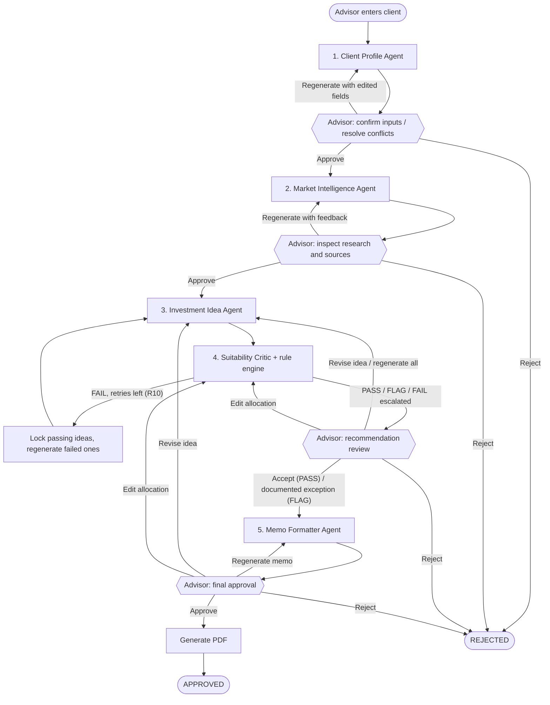

# UBS Human-Led Multi-Agent Financial Advisory System

A human-led multi-agent investment advisory application for UBS financial advisors (Relationship Managers), built with **LangGraph**, **Pydantic v2**, **OpenRouter**, **FastAPI** and **Streamlit**. It follows the *Personalized Financial Advisory (AAFS v2)* design: the app is the advisor's decision workspace, and the PDF memo is the final advisory artifact.

---

## 1. Design Principles

1. **Clear role boundaries**: five agents, each owning one kind of reasoning, hand off typed Pydantic objects.
2. **Human accountability by design**: the advisor confirms inputs, reviews research, decides on recommendations and approves the memo. No PDF exists before advisor sign-off.
3. **Evidence before recommendation**: every market claim carries a source and publication date; sources older than 30 days are excluded (R8).
4. **Deterministic control where possible**: risk scores, exposures, allocation totals and every suitability rule run in pure Python (`src/tools/`, linted to never import LLM code). Models handle language, relevance and synthesis.
5. **Lowest effective level of automation**: research and drafting are automated; client understanding, exceptions and final approval stay with the advisor.

---

## 2. Workflow and Advisor Checkpoints



| Checkpoint | Advisor actions | Notes |
|---|---|---|
| Client profile | `approve`, `regenerate` (with `edits` to the intake fields), `reject` | Approve is unavailable while mandatory fields are missing (R1). Approving resolves flags such as R5 with the advisor's note. |
| Research brief | `approve`, `regenerate` (notes become feedback), `reject` | Advisor can inspect every source and its date. |
| Recommendations | `approve` (PASS only), `override_flag` (FLAG, note required), `revise` (one idea via `idea_id`, others locked), `edit_allocation`, `regenerate` (all ideas), `reject` | A FAIL can never be approved. FAILed ideas are regenerated automatically up to 2 times per idea before reaching the advisor (R10). An edited allocation is re-validated and returned to the advisor, never auto-regenerated. |
| Final approval | `approve` (generates the PDF), `regenerate`, `revise`, `edit_allocation`, `reject` | Approve is unavailable if the memo fails R9 wording or the consistency check. |

`add_advisor_note` can be sent at any time; it is logged but never acts as a review decision. Advisor notes and feedback are passed to models as quoted data, not instructions.

---

## 3. Suitability Rule Engine (`src/tools/risk_engine.py`, `config/suitability_policy.yaml`)

| # | Check | Default | Outcome |
|---|---|---|---|
| R1 | Mandatory fields: objective, horizon, risk profile, liquidity need, investable amount | any missing | BLOCK |
| R2 | Instrument in the approved universe file | not found | FAIL |
| R3 | Post-trade allocations sum to 100% (purchases are funded) | ±0.01 pt | FAIL |
| R4 | Proposed portfolio risk score within the client's band | band ceiling | FAIL (FLAG if an existing breach is not worsened) |
| R5 | Risk willingness above risk capacity | any gap | FLAG, lower band applied |
| R6 | Growth-asset share when the horizon is 3 years or less | cap 30% | FAIL (FLAG if existing, not worsened) |
| R7 | Single market, sector or instrument share after the change | 30% (instrument: client limit if lower) | FLAG existing, FAIL if new or worsened |
| R8 | Every cited source retrieved and within the freshness limit | 30 days | FAIL missing, FLAG stale |
| R9 | Prohibited wording ("guaranteed", "risk-free"); negated uses allowed | any match | FAIL |
| R10 | Automatic regenerations of the same idea | max 2 | Escalate to advisor |
| L1 | Liquid assets cover liquidity needs due within 24 months | 1.0x | FAIL (FLAG if existing, not worsened) |

Thresholds are illustrative defaults held in configuration and must be calibrated against UBS suitability policy before any pilot. A portfolio-level FAIL is attributed to the smallest set of ideas whose removal fixes it, so only those slots are regenerated.

---

## 4. The Five Agents

| Agent | Role | Deterministic tools |
|---|---|---|
| Client Profile (`client_profile.py`) | Standardise advisor inputs, compute risk band (lower of willingness and capacity), flag gaps and conflicts | `required_field_validator`, `risk_profile_calculator`, `portfolio_parser` |
| Market Intelligence (`market_intelligence.py`) | Retrieve and synthesise client-relevant research with sources and dates | `retrieval_rag_tool`, `source_freshness_validator`, `quantitative_analysis_tool`, `sentiment_analysis_tool` |
| Investment Idea (`investment_idea.py`) | Three complementary ideas from the approved universe, each with role, conviction, risks, invalidation trigger and alternative considered | `approved_product_universe_tool`, `portfolio_exposure_calculator` |
| Suitability Critic (`suitability_critic.py`) | PASS / FLAG / FAIL per idea and overall from the rule engine | `suitability_rule_engine` |
| Memo Formatter (`memo_formatter.py`) | 3-page memo: executive recommendation, idea details, portfolio view; restates guarantee requests as targets; R9 and consistency checks | `memo_consistency_validator`, `citation_source_mapper`, `pdf_memo_renderer` |

---

## 5. Models (OpenRouter)

Set an OpenRouter key to use hosted models; without it the app runs in a deterministic **offline mode** (canned agent outputs, useful for demos and tests).

```bash
export OPENROUTER_API_KEY=...
export OPENROUTER_MODEL=anthropic/claude-sonnet-4.5             # default model for every agent
export OPENROUTER_MODEL_INVESTMENTIDEAAGENT=openai/gpt-4.1      # optional per-agent override
```

Agent outputs are validated against their Pydantic schema; invalid output is retried once with the validation errors, then the agent raises `LLMUnavailableError` ("data unavailable") instead of guessing. The model and prompt version of every agent call are written to the run log.

---

## 6. Audit Run Log

Each session is one run ID. `data/runs/<session_id>.jsonl` (override with `RUN_LOG_DIR`) records the client inputs, policy version, every agent output with model and prompt version, rule results, automatic regenerations, advisor decisions and notes, PDF generation and the final outcome. `GET /sessions/{id}/audit` returns it.

---

## 7. Running

```bash
pip install -r requirements.txt
streamlit run streamlit_app.py                                   # advisor workspace
uvicorn src.api.app:app --host 0.0.0.0 --port 8000 --reload      # REST API
python -m pytest tests/ -v                                       # offline test suite
```

### Demo clients (`data/samples/client_profiles.json`)

| Client | Profile | Control shown |
|---|---|---|
| Sarah, 38 | S$750k, moderate, 7-year property goal, 42% US equities, wants income | US growth idea fails R4/R7 and is regenerated automatically; existing US concentration is a FLAG the advisor documents |
| Daniel, 29 | S$220k, "comfortable with high risk", S$180k deposit in 15 months | R5 willingness vs capacity: band lowered to Conservative; growth capped (R6) |
| Mdm Lim, 62 | S$1.2M, low-moderate risk, retiring in 3 years, wants a "guaranteed 6%" | Memo restates the request as a target and states returns cannot be guaranteed (R9) |
| Aaron, 45 | S$400k, moderate, no horizon given | R1 blocks the workflow until the horizon is supplied |

### REST API

| Method | Endpoint | Description |
|---|---|---|
| `POST` | `/sessions` | Start a session with the client intake; runs to the first advisor checkpoint |
| `GET` | `/sessions/{id}` | Workspace view, including `pending_review` (agent output, `allowed_actions`) |
| `POST` | `/sessions/{id}/actions` | Advisor decision: `approve`, `regenerate`, `reject`, `revise`, `override_flag`, `edit_allocation`, `add_advisor_note` (optional `idea_id`, `notes`, `edits`). 400 if not allowed at the current checkpoint |
| `GET` | `/sessions/{id}/pdf` | Approved memo PDF (exists only after final approval) |
| `GET` | `/sessions/{id}/audit` | Audit trail and full run log |
| `GET` | `/health` | Health check |

### Tests

- `tests/unit/test_risk_engine.py`: every rule R1-R10 and L1, existing-vs-worsened outcomes, idea attribution.
- `tests/unit/test_openrouter_client.py`: schema validation, retry on invalid output, fail-safe error, per-agent models.
- `tests/integration/test_trajectories.py`: full trajectory with PDF only after approval; automatic regeneration then R10 escalation; a FAIL never reaches the memo; selective revision locks other ideas; allocation edits re-validated; FLAG needs a documented exception; demo-client controls; audit log contents.
